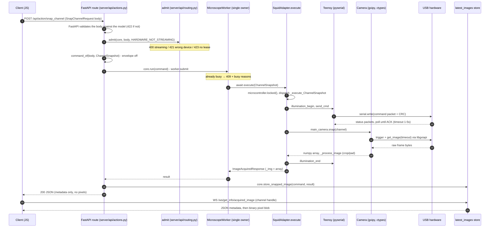

# seafront — backend internals

This directory is the Python package that runs the microscope. It is a headless-first
FastAPI server that talks to hardware (cameras, stage, illumination, autofocus) and serves
a static web UI. This document describes how the code is wired together — the request path,
the (unusual) OpenAPI generation, the concurrency/locking model, and the hardware
abstraction — so you can navigate `__main__.py` without reading all ~2500 lines first.

> For *usage* (how to run, test, lint) see the repo-root `CLAUDE.md`. This file is about
> *how the backend is built*.

## Module map

```
seafront/
├── __main__.py            entry point: pick a microscope, build the Core, serve (~270 lines)
├── logger.py              loguru setup (stderr INFO, ~/seafront/logs/log.txt DEBUG)
├── debug_introspect.py    "where is everybody executing?" thread/task stack dumps
│
├── server/
│   ├── app.py             the FastAPI app: routers, static files, error handlers
│   ├── core.py            Core — everything the server can do to the microscope, no HTTP
│   ├── asyncapi.py        /asyncapi.json, generated from the socket declarations
│   ├── commands.py        Pydantic request/response models + BaseCommand[T] hierarchy
│   ├── lock.py            DeviceLock — the client-held lease above the worker
│   ├── worker.py          MicroscopeWorker — single owner of the hardware
│   ├── protocol.py        acquisition protocol: well/site/channel iteration, Z-stacks,
│   │                      OME metadata, file storage, AsyncThreadPool
│   └── api/
│       ├── routing.py     Policy + the gate every request passes through
│       ├── envelope.py    Envelope (target_device, lock_token) and command_of
│       ├── requests.py    the request body of every route, declared once
│       ├── messages.py    what travels over the websockets
│       ├── socketspec.py  how a socket declares its frames
│       ├── tags.py        /docs grouping
│       ├── info.py  actions.py  acquisition.py  lock.py  sockets.py   the route table
│       ├── socketspec.py  the socket gate: declares each socket AND enforces it
│
├── config/
│   ├── registry.py        ConfigRegistry — decentralized config registration
│   ├── handles.py         type-safe enum config keys (no magic strings)
│   ├── core_config.py     GlobalConfigHandler — file I/O, override stack
│   └── basics.py          ConfigItem, ChannelConfig, FilterConfig, ServerConfig ...
│
└── hardware/
    ├── microscope.py      Microscope ABC + Locked[T] wrapper + HardwareLimits
    ├── squid.py           SquidAdapter — real Cephla SQUID implementation
    ├── mock_microscope.py MockMicroscope — synthetic images, simulated motion
    ├── illumination.py    IlluminationController (per-channel calibrated intensity)
    ├── forbidden_areas.py stage keep-out regions
    ├── camera/            Camera ABC + galaxy_camera / toupcam_camera / mock_camera
    └── microcontroller/   Microcontroller ABC + teensy_microcontroller (USB serial)
```

## The application flow

Three data paths share the one `Microscope` instance:

1. **Synchronous commands** — `POST /api/action/*` and `/api/get_*`. Request → policy gate →
   worker → `execute()` → JSON response. This is the bulk of the API, and the path traced
   below.
2. **Live preview** — `stream_channel_begin` puts the camera in continuous mode; each frame
   is stored into `latest_images`, and the client pulls frames over the
   `/ws/get_info/acquired_image` WebSocket (JSON metadata, then a binary blob).
3. **Background acquisition** — a long-running protocol is submitted to the same worker as a
   labelled job, reporting progress over `/ws/acquisition/status`.

Here is a *concrete* trace of path 1 — `POST /api/action/snap_channel` (take one image on one
channel) — from the HTTP boundary down to the USB hardware and back. Every hop cites the code
so you can follow it.



What the diagram compresses:

- **One hardware owner** (`F→W`): commands do not run on the request's event loop. They are
  submitted to `MicroscopeWorker`, which holds the hardware for the whole command (see
  Concurrency).
- **409 = busy**: `worker.submit` answering `None` means something else is in flight;
  `Core.run` turns that into a 409 naming the busy reasons. Requests are never queued.
- **Microcontroller hop** (`teensy_microcontroller.py`): `illumination_begin` builds a
  fixed-length packet (opcode + args + cmd id + CRC), `send_cmd` writes it over pyserial,
  then polls status packets until the Teensy echoes the matching cmd id — bounded by a 1–5 s
  timeout.
- **Camera hop** (`galaxy_camera.py`): `snap` triggers, then
  `get_image(timeout=exposure+2000ms)` → `gxipy` → `ctypes` → `libgxiapi.so` → USB;
  `_process_image` crops/pads. That timeout is the *only* bound on a hung camera.
- **Pixels return separately**: the HTTP response is metadata only. `store_snapped_image`
  puts the array in `latest_images`; the client fetches the downsampled frame as a binary blob over
  `/ws/get_info/acquired_image`, keeping multi-MB data off the JSON path.

### Two hardware transports

| | Microcontroller (stage, illumination, filter wheel) | Camera (main + autofocus) |
|---|---|---|
| Driver | `microcontroller/teensy_microcontroller.py` | `camera/galaxy_camera.py`, `camera/toupcam_camera.py` |
| Transport | pyserial (USB CDC), fixed-length packets + CRC | vendor SDK (`gxipy`/`toupcam`) → `ctypes` → `.so` → USB |
| Call shape | write packet, poll status until matching cmd id | trigger + blocking `get_image(timeout)` or continuous callback |
| Bounded? | yes — ack-poll timeout (1–5 s) | `get_image` yes; **`stream_off`/`unregister_capture_callback` no** |
| Failure handling | `_usb_operation_with_reconnect` decorator (bounded close/reopen retries) | `_camera_operation_with_reconnect` decorator (bounded close/reopen retries) |

The mocks (`mock_microscope.py`, `mock_camera.py`) replace both transports with synthetic
images and simulated motion, so the whole flow runs with no hardware (`--microscope mocroscope`).

## Request routing — one declaration per endpoint

Every `/api` route is registered through `Api.post` in `server/api/routing.py`, which states
the route's **policy** next to the handler:

```python
@api.post("/api/action/move_to", policy=HARDWARE)
async def move_to(body: MoveToRequest, core: CoreDep) -> BasicSuccessResponse:
    """move to target coordinates"""
    return await core.run(command_of(body, MoveTo))
```

That one line of policy does three jobs that used to be done in three places: it is enforced
at request time, it decides which error responses the route documents, and all three of its
parts are published in the schema (`x-requires-device-lease`, `x-allowed-while-acquiring`,
`x-allowed-while-streaming`). They cannot drift, because they are the same object.

`tests/test_route_policy.py` drives every route against every state and holds the result
against those published flags — and, separately, holds the published flags against a list of
what they are *meant* to be, because a consistency check alone stays green when somebody
relaxes a Policy: the flag and the enforcement move together.

Request bodies are strict (`Envelope` sets `extra="forbid"`), so a field this server does not
know is a 422 rather than something silently dropped. Only the top level: nested seaconfig
models keep their own rules.

The six policies are the whole access model:

| Policy | lease | during an acquisition | during a live stream |
|---|---|---|---|
| `HARDWARE` | yes | yes | yes |
| `HARDWARE_NOT_STREAMING` | yes | yes | no |
| `HARDWARE_NOT_ACQUIRING` | yes | no | yes |
| `HARDWARE_IDLE` | yes | no | no |
| `READ` | no | yes | yes |
| `LEASE_ADMIN` | no (but answers 423) | yes | yes |

What a request passes through, in order:

```
body        422   the body does not match the route's request model (FastAPI)
state       400   the microscope is acquiring or streaming, and this route may not run then
routing     421   the request names a different microscope than this server drives
lease       423   the caller does not hold the device lease (hardware routes only)
handler           a Core method, or a command submitted to the worker
worker      409   a command is already in flight (reject-on-busy, raised by Core.run)
```

Body validation happens first, so a malformed request is refused before the gate is
consulted — an invalid body can never be mistaken for a lease refusal.

### The envelope

Every request body is `Envelope` + the payload:

```python
class MoveToRequest(Envelope, MoveTo):
    pass
```

`Envelope` carries `target_device` and `lock_token`; the payload half *is* the command class
from `commands.py`, so a field is defined exactly once. On the wire the body stays flat.
`command_of(body, MoveTo)` takes the envelope back off at the boundary, so the hardware layer
only ever sees a command that knows nothing about HTTP.

Handlers read top to bottom. There is no `callback=` indirection: what happens after a
command (storing the image, installing the stream callback) is written after the command.

## OpenAPI generation — there isn't any

`/openapi.json` is FastAPI's own, generated from the request and response models the routes
are annotated with. There is no second description of the API to keep in step.

This used to be a ~240-line hand-rolled walker over `app.routes` that rebuilt the schema from
introspection, and it was wrong: it published every POST body as query parameters, emitted no
`requestBody` at all, and typed 83 of 107 parameters as bare `string` because its
`type_to_schema` fell through to `{"type": "string"}` for anything it did not recognise. A
client generated from that document could not call the API.

What holds it correct now:

- Request bodies are explicit models in `server/api/requests.py`, not models synthesised from
  a handler signature — so FastAPI can describe them.
- Response models are inferred from each handler's return annotation, which is also what
  FastAPI validates the response against. The documented response *is* the enforced one.
- `separate_input_output_schemas=False` keeps one schema per model rather than an
  `-Input`/`-Output` pair, so clients get one name per thing.
- `scripts/generate_api_types.py` derives the browser's TypeScript types from the same
  documents, and `scripts/check.py` fails if the committed copy is stale.

Websockets are published separately, as AsyncAPI — see below.

## The command model (`server/commands.py`)

`BaseCommand[T]` is a generic marker. Concrete commands multiply-inherit
`(BaseModel, BaseCommand[SomeResult])` and declare `_ReturnValue: type = PrivateAttr(default=SomeResult)`.
The request fields *are* the Pydantic model fields; the response type is `_ReturnValue`.
`SquidAdapter.execute()` is a big `isinstance` dispatch that routes each command to an
`_execute_<Name>` coroutine. `error_internal(detail=...)` raises the canonical 500-style
error used throughout.

## Concurrency and locking — read this before touching hardware code

This is the subtle part and the source of past deadlocks.

**One owner.** `MicroscopeWorker` (`server/worker.py`) is a daemon thread that owns the
microscope and runs one thing at a time. Route handlers stay on the event loop and hand work
over with `submit` / `submit_job`, then `await asyncio.wrap_future(...)` for the result. The
single in-flight slot is a `threading.Lock` claimed by the submitter and released by the
worker when the work finishes; claiming it *is* the reject-on-busy gate, and holding it *is*
`is_busy`.

**One request, one claim.** A request that drives the hardware claims the worker once, for
everything it does — `submit(command)` runs the lazy `EstablishHardwareConnection` and the
command itself inside the same claim, and the orchestrations (`snap_selected_channels`, an
acquisition run) do the same through `submit_job`. This is load-bearing, not tidiness:
claiming twice leaves a hole between the claims where another command runs inside the
request, where `is_busy` reads false while the request is still going, and where the request
that got there first comes back 409 because a later one took the slot it had just released.
`tests/test_concurrency.py::TestOneRequestIsOneClaim` watches for exactly that from outside.

**409 = busy.** `submit` / `submit_job` return `None` when the slot is taken, and the route
turns that into a 409 whose body carries `_busy_reasons()` — the in-flight job's label, so
the rejection names *what* the hardware is doing (`hardware busy: MoveTo`,
`hardware busy: acquisition:<id>`). Not to be confused with 423, which is the client-held
device lease (see below): 409 is "the hardware is busy right now", 423 is "this is not your
microscope".

**Kept locks.** `Locked[T]` (in `microscope.py`) wraps a value with an `RLock` and a
`locked(blocking=...)` context manager that yields `None` if it can't acquire; it survives for
the per-camera guards that are read off the worker thread (e.g. `get_hardware_limits`),
alongside the microcontroller's own internal lock and the narrow `_stream_lock` that guards
the adapter's stream state. The old nested `Microscope.lock()` / `get_lock_reasons()`
hierarchy is gone.

**Rules for anything running on a hardware/SDK-owned thread (e.g. a camera streaming
callback):**

- It must **not** acquire a lock that any other thread can hold, and must not block. Camera
  SDK stop calls (`stream_off`, `unregister_capture_callback`) synchronously join the SDK's
  acquisition thread with **no timeout**; if your callback blocks on a lock the stopping
  thread holds, you deadlock forever. (This is exactly the bug that motivated
  `debug_introspect.py`.) The streaming callback in `squid.py` snapshots what it needs (e.g.
  pixel format) up front, and `Microscope._forward_frame` reads the stream state under
  `_stream_lock` and then calls the sink from *outside* it, so a slow consumer can never hold
  up a stream stopping.
- Blocking C/FFI calls can hang indefinitely and cannot be interrupted in-process — only
  bounded-timeout SDK calls (like `get_image(timeout=...)`) are safe to wait on.

## Configuration (three-tier)

Effective config = **code defaults** → **file overrides** (`~/seafront/config.json`, JSON5)
→ **runtime overrides**. Components register their own defaults through `ConfigRegistry`
(decentralized — no central schema). Keys are enum handles (`config/handles.py`), not magic
strings. `GlobalConfigHandler` owns file I/O and the override stack (`override(...)` is
applied per request from `machine_config` in the body).

Items registered with `privileged=True` (calibration, device identity, hardware-asserted
flags) are server-owned: `override()` skips them unless called with `privileged=True`, which
only `/api/action/machine_config_flush` with `privileged: true` and server-internal writers
(laser autofocus / stage calibration) do. A privileged write is persisted with `store()` at
once. Values are validated against the registered `value_kind`/options; unknown handles are
ignored and reported (`OverrideResult`).

## Device lock (client lease)

`seafront/server/lock.py` holds one lease per process (= per device): owner label, secret
token, expiry. **The lease is required, not advisory.** A route whose policy sets
`requires_lease` (the default) refuses a request with **423** unless it carries the current
lease's `lock_token` (an envelope field, like `target_device`) - an unheld lease denies everyone
(`reason: "not_held"`) rather than letting everyone through, and a lease somebody else holds
denies with `reason: "held_by_other"` plus the owner. Opted out: reads, `acquisition/cancel`,
`cancel_current` (safety hatch: cancel is never gated), the acquisition config file routes
(they write protocol files, not hardware), `establish_hardware_connection` (it is "are the
devices there?", and the cold connect that homes the stage is the server's own at startup)
and `/api/lock/*`.

`DeviceLock.check(token)` makes that decision and renews the holder's expiry in one atomic
step; every request calls it, so a holder's lease is kept alive by anything it does, gated or
not. Expiry is lazy, and the *device being in use* renews it too - a command on the worker or
a running camera stream is by definition the holder's work, since nobody else could have
started it. That is a renewal and not a freeze: a lease that were merely pinned open while
busy would lapse the instant a six-hour run ended, which is the one moment the holder still
needs it (to park the stage, to kill the illumination). A stream matters here as much as the
worker does, because `ChannelStreamBegin` gives the worker slot straight back and the camera
then runs for as long as the client wants. `/api/lock/break` is open to anyone and logs owner
+ reason at WARNING. Coordination, not auth.

## Streaming

The adapter owns it. `Microscope._stream` (a frozen `StreamState`: channel + start time,
under `_stream_lock`) is set inside `ChannelStreamBegin` *before* the camera starts and
cleared inside `ChannelStreamEnd`, and `stream_state()` is what both `get_current_state` and
the policy gate read. `ChannelStreamEnd` carries no channel: it stops whatever is running and
turns off the illumination of the channel the adapter actually lit.

The frame sink is installed once, by `Core.__init__`, and `_forward_frame` gates on the
stream state. Nothing installs or removes a callback around a stream, so there is no window
where the camera is producing frames that nobody is listening for.

A gated route is POST: a GET carries no body, so it could never carry `lock_token`.
`/ws/action/snap_selected_channels_progressive` drives hardware too and takes the token in its
handshake, closing with **4423** instead of answering 423. Every route publishes
`x-requires-device-lease` in `/openapi.json` and every channel publishes it in
`/asyncapi.json`, which is what the UI and `tests/test_lock_enforcement.py` read - that test
sweeps both schemas, so a hardware route added later is covered without anyone remembering to
list it.

## WebSocket data flows

Sockets are published as **AsyncAPI 3.0** at `/asyncapi.json`, not in the OpenAPI document —
OpenAPI has no vocabulary for "the server pushes one of these until you go away". The
document is generated from what each handler declares, the same way routes generate theirs:

```python
@socket(
    router,
    "/ws/action/snap_selected_channels_progressive",
    requires_lease=True,
    receive=[HANDSHAKE, Frame("protocol", "the config whose channels to snap", ProgressiveSnapRequest)],
    send=[Frame("progress", "one update per channel", ChannelSnapProgressiveStatus), ...],
    close_codes=MISDIRECTED_CLOSE | {4423: "device lease missing or held by another client"},
)
```

| Channel | Purpose | Needs the lease |
|---|---|---|
| `/ws/get_info/current_state` | poll stage/hardware state | no |
| `/ws/get_info/acquired_image` | live preview frames | no |
| `/ws/acquisition/status` | acquisition progress | no |
| `/ws/action/snap_selected_channels_progressive` | progressive multi-channel snap | yes |

Every socket opens with a `SocketHandshake` naming the target device (close code 4421 on
mismatch), and the one that drives the hardware also reads `lock_token` from it (4423,
mirroring the HTTP 423). Every inbound message afterwards is parsed through a model in
`server/api/messages.py` before anything acts on it — a socket takes client JSON exactly as
sceptically as a POST body does.

`x-requires-device-lease` means the same in both documents, so
`tests/test_lock_enforcement.py` sweeps routes and channels the same way.

## Debugging a hang

`debug_introspect.py` answers "where is everybody currently executing?" — essential given
the async-inside-async-inside-thread structure. Three ways to get a dump, most-robust first:

1. `kill -USR1 <pid>` — faulthandler C-level dump of all thread stacks to stderr; works even
   when the GIL is stuck in a C call.
2. `kill -USR2 <pid>` — rich dump (thread stacks + microscope lock reasons + asyncio tasks)
   to a timestamped file under `~/seafront/logs/`.
3. `GET /api/debug/stacks` — same rich dump as text; responds even while other request
   threads are blocked, because each request runs in its own thread.

Because each request is its own thread and hardware waits are synchronous blocks, a wedged
request shows up as a thread whose stack ends exactly at the blocking line.
